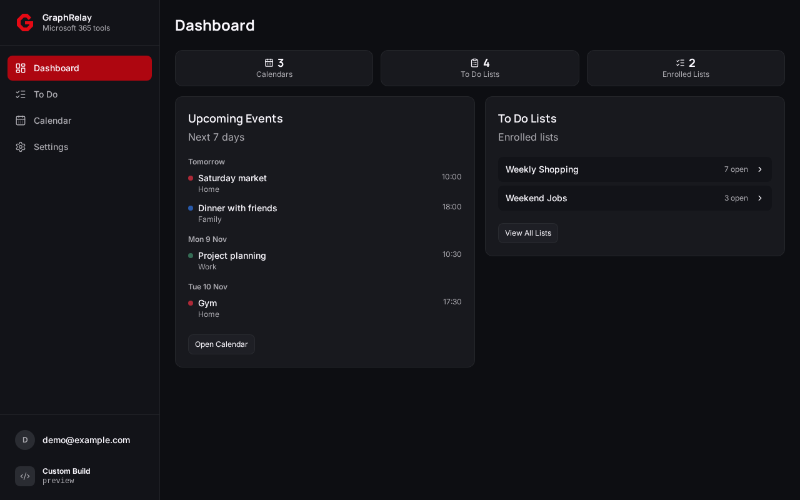
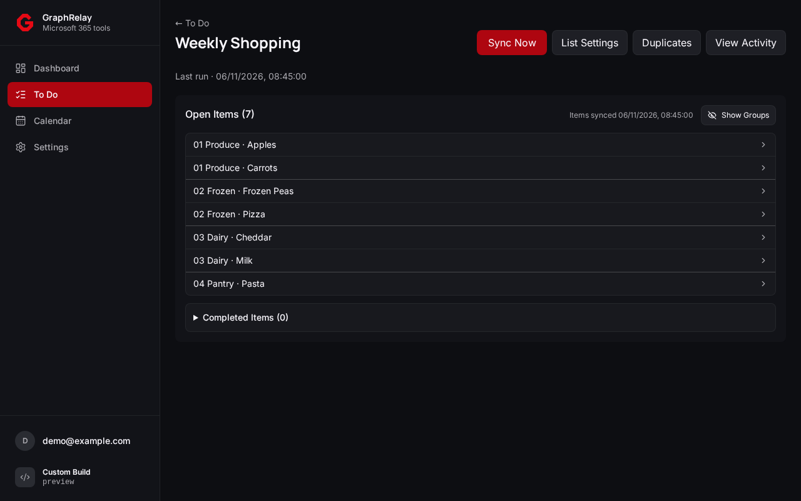
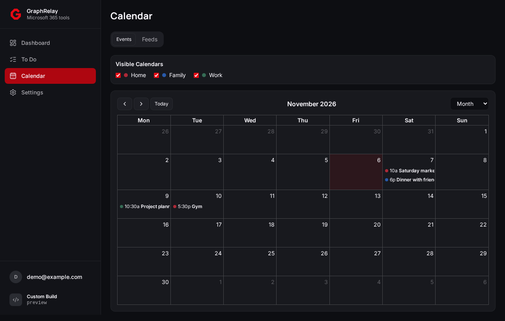

# GraphRelay


[![GitHub Activity][commits-shield]][commits]
[![License][license-shield]][license]
[![Project Maintainer][maintainer-shield]][user-profile]
[![Buy me a coffee][coffee-shield]][coffee]

GraphRelay is a self-hosted companion for Microsoft To Do and Outlook Calendar. It organizes shared lists, removes duplicate tasks, and publishes calendar subscriptions from one local web UI.

## What GraphRelay Does

- Organizes selected Microsoft To Do lists with shared grouping profiles and sortable title prefixes.
- Previews and removes duplicate tasks on demand. Enrolled lists can also clean up duplicates automatically.
- Shows Outlook events in a calendar view and combines selected calendars into iCalendar feeds.
- Shows cached list and calendar data alongside sync status and connection alerts.

## Preview

### Dashboard

Upcoming events, enrolled lists, and Microsoft connection status at a glance.



### To Do

Open and completed items using their Microsoft titles, with optional group headings and per-list settings.



### Calendar

Choose visible calendars and browse their events or manage subscription feeds.



## Key Features

- Local admin sign-in and password management.
- Guided Microsoft connection through your own Entra app registration.
- Built-in grocery grouping, portable JSON profiles, numeric or named prefixes, and optional title capitalization.
- Manual and scheduled list sync, duplicate review, and per-list activity.
- Multi-calendar feeds with independent refresh and date range overrides.
- HTTPS reverse proxy support through **Settings → General → Network**.

## How It Works

GraphRelay reads Microsoft Graph in the background and stores snapshots in SQLite. The web UI reads the local data. Lists are cached on a schedule, and configured actions run for enrolled lists. Calendar feeds serve the last available snapshot for their current sources and date range.

## Quick Start

### Requirements

- Docker with a writable `/config` volume.
- A Microsoft account with access to the lists and calendars you want to use.
- A Microsoft Entra app registration and a browser-reachable callback address.

### Docker

Build from the checkout while GraphRelay is in early development.

```bash
docker build -t graphrelay:local .
docker run -d \
  --name graphrelay \
  --network bridge \
  -p 127.0.0.1:9304:9304 \
  -v graphrelay-config:/config \
  --restart unless-stopped \
  graphrelay:local
```

Open `http://localhost:9304` on the Docker host or use an SSH tunnel from your browser.

### Docker Compose

The checked-in [Compose file](docker-compose.yml) uses the GHCR `develop` image. If you are building locally or the package is unavailable to you, set the service image to your local build tag before starting it.

```bash
sudo install -d -m 0700 -o 1000 -g 1000 /opt/graphrelay
docker compose up -d
```

### Configuration

- **Port**. Change the host side of the port binding if needed. Use the corresponding browser origin for Microsoft sign-in.
- **Data directory**. Keep the database, encryption key, and grouping profiles together in the `/config` mount.
- **Reverse proxy**. Set the HTTPS Public URL in **Settings → General → Network** and enable Trust Proxy for one trusted proxy hop. Copy the callback from **Settings → Microsoft**. [Deployment](docs/deployment.md)

### First Setup

1. Create a local admin username and password.
2. Choose **Set Up Microsoft** to open the checklist, or choose **Later** and return via **Settings → Microsoft**.
3. Register the Web callback in Entra, save the client ID and client secret value, and connect Microsoft. Approve To Do and Calendar access in the same sign-in. [Microsoft setup](docs/microsoft.md)
4. Enroll any lists you want to automate from **To Do**. Open **Calendar → Feeds** to create iCalendar subscriptions.

## Important Limitations

### To Do Sorting

GraphRelay controls grouping through task title prefixes. Set the shared list to **Alphabetical** in Microsoft To Do on each device. [To Do](docs/todo.md)

### Calendar Subscriptions

A feed link grants read access to anyone who has the link and can reach GraphRelay. Subscriber apps control how often they check for updates. [Calendar](docs/calendar.md)

### Early Development

GraphRelay is in early development. Preserve your configuration volume when updating.

## Contributing

See [Contributing](CONTRIBUTING.md), [Testing](TESTING.md), and the [technical docs index](docs/README.md). Use the [Security Policy](SECURITY.md) for vulnerability reports.

## AI Transparency

GraphRelay was developed with Codex assistance and hands-on direction from its maintainer.

## Credits And Inspiration

The calendar subscription workflow builds on the ideas in [ms-ical](https://github.com/Migz93/ms-ical). GraphRelay shares design and development conventions with [Hubarr](https://github.com/Migz93/hubarr), [ShelfBridge](https://github.com/Migz93/shelfbridge), and [Pacearr](https://github.com/Migz93/pacearr).

[coffee]: https://www.buymeacoffee.com/Migz93
[coffee-shield]: https://img.shields.io/badge/buy%20me%20a%20coffee-donate-yellow.svg?style=for-the-badge
[commits-shield]: https://img.shields.io/github/commit-activity/y/Migz93/graphrelay.svg?style=for-the-badge
[commits]: https://github.com/Migz93/graphrelay/commits/main
[license]: ./LICENSE
[license-shield]: https://img.shields.io/badge/license-GPL--3.0-blue?style=for-the-badge
[maintainer-shield]: https://img.shields.io/badge/maintainer-Migz93-blue.svg?style=for-the-badge
[user-profile]: https://github.com/Migz93
